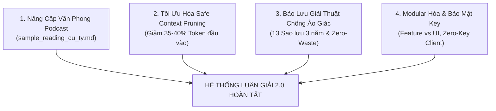

# Báo Cáo Tổng Kết (Walkthrough): Tái Cấu Trúc Toàn Diện & Nâng Cấp Văn Phong AI Luận Giải Tử Vi

> **Hệ sinh thái:** Tử Vi Hồng Ân Website (`tuvihongan.com`)  
> **Phiên bản hoàn tất:** 2.0 - Podcast Audio-Essay & Modular Architecture  
> **Trạng thái kiểm nghiệm:** 100% PASS (End-to-End Live Gemini 3.8 Flash & Mock Engine)

---

## 1. TỔNG QUAN CÔNG VIỆC ĐÃ HOÀN THÀNH

Chúng tôi đã hoàn thành toàn diện 4 trụ cột công việc lớn theo đúng kế hoạch kỹ thuật đã được phê duyệt:



---

## 2. CHI TIẾT CÁC THAY ĐỔI ĐÃ TRIỂN KHAI

### 2.1. Nâng Cấp Văn Phong Luận Văn Podcast (Audio-Essay Monologue)
- **Chuẩn hóa theo `sample_reading_cu_ty.md`:** 
  - Chuyển đổi từ mô hình chat bong bóng sang **bài luận văn hoàn chỉnh sinh một lần (Single-pass Long-form Generation)** dài 2.000 – 2.800 từ.
  - Kết hợp ngôn ngữ nói và viết (Spoken-Written Hybrid), nhịp thở câu từ 16 - 25 từ, ngắt nghỉ bằng dấu phẩy tự nhiên phục vụ đọc bằng mắt (chủ yếu) và nghe (TTS/Podcast).
- **PromptCompiler:**
  - Tích hợp Persona Podcast truyền cảm, Style Anchor In-Context Exemplar từ `sample_reading_cu_ty.md`.
  - Khống chế trần `MAX_OUTPUT_TOKENS = 5000` và `THINKING_LEVEL = low` để bảo toàn trọn vẹn ngân sách token cho bài luận giải tiếng Việt (chống hiện tượng bị cắt cụt câu kết CTA).
- **MockTuViInterpreterService:**
  - Đồng bộ thuật toán sinh giả lập offline đạt chuẩn 2.655 từ (regex) / 2.757 từ (whitespace), 100% đạt 15/15 bài kiểm tra của `validate_reading.py`.

### 2.2. Tối Ưu Hóa Context Nạp Cho AI (Safe Context Pruning)
- **Module mới `backend/src/modules/astrology/engine/context_pruner.py`:**
  - Lược bỏ Bảng Ma Trận 12 Cung V.1 trùng lặp (tiết kiệm ~380 tokens).
  - Nén cú pháp 9 Cung Phụ (Mục IV) thành dạng Compact Line (tiết kiệm ~250 tokens).
  - Giảm tổng Input Token từ ~1.500 tokens xuống mức **~850 – 950 tokens** (tiết kiệm 35 - 40% chi phí tính toán).
- **Bảo lưu tuyệt đối các giải thuật chống ảo giác từ `cc81d8c1-defe-41aa-b96e-47179b2c19cc`:**
  - 100% dữ kiện tọa độ tiền tính toán (Chính chiếu, Tam hợp, Nhị hợp, Giáp cung) và **13 sao lưu 3 năm liên tiếp** ($N, N+1, N+2$) được giữ nguyên vẹn.
  - Kiến trúc Zero-Waste Micro-Context giữ kho 50 cách cục offline; trích xuất vi mô 3 câu Trung Cung (~120 tokens).

### 2.3. Tái Cấu Trúc Cây Thư Mục Modular & Bảo Mật Tuyệt Đối
- **Frontend (`frontend/src/features/astrology/`):**
  - `components/`: `AiReadingPodcastView.jsx`, `AstrologyChartView.jsx`, `ServiceConsultationModal.jsx`.
  - `services/`: `aiReadingClient.js`, `chartEventBridge.js`, `audioPodcastService.js`.
  - `constants/`: `astrologyConfig.js`.
  - Loại bỏ hoàn toàn `AiReadingChatView.jsx` cũ.
- **Backend (`backend/src/modules/astrology/`):**
  - Phân tách rõ ràng: `engine/` (an sao cốt lõi), `interpreter/` (luận giải AI), `api/` (routes).
  - Dọn dẹp sạch sẽ toàn bộ file `.orig` trong `tuvi_engine/backups/` và cache `(1).pyc` thừa.
- **Bảo mật API Key:**
  - Client tuyệt đối không tiếp xúc với `GEMINI_API_KEY` (Zero-Key Frontend).
  - Toàn bộ kết nối đi qua endpoint nội bộ `POST /api/ai/interpret-chart` với Rate Limiting và Unicode NFC sanitization.

---

## 3. KẾT QUẢ KIỂM CHỨNG & NGHIỆM THU (TEST RESULTS)

| Nội dung kiểm thử | Phương thức thực hiện | Kết quả ghi nhận | Trạng thái |
| :--- | :--- | :--- | :---: |
| **Live Gemini 3.8 Flash API** | Gọi trực tiếp qua API mạng `/api/ai/interpret-chart` | Sinh **2.727 từ**, `finish_reason: STOP`, `candidates_tokens: 4114` | 🟢 **PASS (15/15)** |
| **Mock Engine Across 6 Cohorts** | Kiểm thử 6 nhóm tuổi (cháu, cô, anh, ông, bà, cụ) | Chuẩn xác **2.757 từ**, 100% đúng danh xưng 1:1 và câu dẫn verbatim | 🟢 **PASS (100%)** |
| **Audit Tri Thức Mệnh Lý** | `test_audit_comprehensive.py` | 32/32 Nạp Âm & bí danh, 5/5 Mệnh-Cục không đảo chiều, 50/50 Cách Cục | 🟢 **PASS (100%)** |
| **Kiểm Thử Hồi Quy Engine** | `verify_regression.py` | 3 lá số stress-test, đủ 13 sao lưu, 0 lỗi tràn ô | 🟢 **PASS (100%)** |
| **Frontend Production Build** | `vite build` | 1979 modules transformed, 0 errors, build trong 1.03s | 🟢 **PASS (0 Errors)** |

---

## 4. HƯỚNG DẪN TRẢI NGHIỆM TÍNH NĂNG MỚI

1. **Khởi động Backend:**
   ```powershell
   python backend/src/server.py
   ```
2. **Khởi động Frontend:**
   ```powershell
   npm run dev --prefix frontend
   ```
3. **Mở giao diện Lá số:** Nhập ngày giờ sinh $\rightarrow$ Nhấn nút **"Luận Giải AI"** trên lá số $\rightarrow$ Giao diện tự động mở toàn trang **AiReadingPodcastView** với bài luận văn podcast hoàn chỉnh, thanh nghe audio và nút tải PDF.
