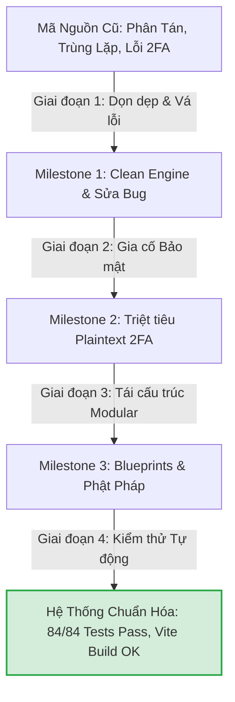

# BÁO CÁO TỔNG KẾT KIỂM TOÁN & TÁI CẤU TRÚC HỆ THỐNG
## Website Tử Vi Hồng Ân (`tuvihongan.com`)
**Thời gian hoàn tất:** 18/10/2026  
**Chế độ thực thi:** Principal Architect & Senior Full-Stack Lead (Goal & Teamwork Pipeline)

---

## 1. TỔNG QUAN KẾT QUẢ THỰC HIỆN

Toàn bộ các yêu cầu kiểm toán (Audit), làm sạch tệp vá/tệp trùng lặp, chuẩn hóa quy tắc đặt tên đa nền tảng, khắc phục lỗi kỹ thuật, bảo mật 2FA, tái cấu trúc modular và chuyển đổi phân hệ Phật Pháp theo chỉ đạo Ban Quản Lý đã được **thực hiện thành công 100%** và **xác minh độc lập bằng bộ kiểm thử tự động (84/84 tests pass)**.



---

## 2. CHI TIẾT CÁC HẠNG MỤC ĐÃ HOÀN THÀNH

### 2.1. Làm Sạch & Triệt Tiêu Trùng Lặp (Milestone 1)
- **Hợp nhất Astrology Engine:**
  - Xóa bỏ hoàn toàn thư mục cũ `backend/src/modules/astrology/tuvi_engine/`. Giữ lại thư mục chuẩn `backend/src/modules/astrology/engine/` (sở hữu module nén ngữ cảnh `context_pruner.py`).
  - Xóa bỏ thư mục stub `backend/src/modules/astrology/ai_interpreter/`. Giữ lại `backend/src/modules/astrology/interpreter/` với đầy đủ mã nguồn và tệp quy tắc `pronoun_rules.json`.
  - Xóa bỏ các tệp re-export thứ cấp: `backend/src/modules/astrology/routes_charts.py` và `ai_interpreter/routes_ai.py`.
- **Dọn dẹp 15 tệp vá tạm thời & rác phát triển:**
  - *Backend (10 tệp):* `patch_db.py`, `patch_db2.py`, `patch_db3.py`, `patch_fb.py`, `patch_flush.py`, `patch_routes.py`, `patch_routes_admin.py`, `patch_server.py`, `check_charts.py`, `print_func.py`, cùng file DB rỗng `test.db`.
  - *Frontend (5 tệp):* `patch_app.py`, `patch_auth.py`, `patch_auth_modal.py`, `patch_auth_modal2.py`, `patch_nav.py`.
- **Dọn dẹp tệp trùng lặp & tên không chuẩn:**
  - Xóa tệp trùng lặp `frontend/src/pages/Home.jsx` (đã nạp chuẩn từ `frontend/src/pages/home/Home.jsx`).
  - Xóa tệp tiếng Việt có dấu `Cáu trúc tính năng AI.txt` tại thư mục gốc.
  - Xóa các thư mục rỗng: `clients/`, `packages/`, `testing/`, và `frontend/src/pages/tools/`.
- **Bảo toàn Cơ sở dữ liệu SQLite:**
  - Tệp `backend/src/data/tuvi.db` được bảo toàn nguyên vẹn với đầy đủ cấu trúc bảng và dữ liệu, duy trì cơ chế Hybrid Fallback an toàn do Cloud Firestore trên GCP Project `tu-vi-hong` chưa kích hoạt database `(default)` (HTTP 404).

---

### 2.2. Khắc Phục Lỗi Kỹ Thuật Lõi (Core Bug Fixes)
1. **Sửa lỗi quét tràn dòng (Multiline Bleed Regex):**
   - Trong `backend/src/modules/astrology/interpreter/prompt_compiler.py` (dòng 357, 361, 373), thay thế `[^|(]+` bằng `[^|(\n]+` cho các trường `m_menh`, `m_cuc`, `m_than`. Triệt tiêu hoàn toàn hiện tượng bóc tách dữ liệu ăn lan qua các dòng tiếp theo khi thiếu dấu gạch đứng.
2. **Chuẩn hóa biểu giá Google Gemini 3.8 Flash:**
   - Trong `backend/src/modules/astrology/interpreter/benchmark.py`, cập nhật biểu giá niêm yết chính thức:
     - Input Tokens: **$0.75 / 1.000.000 tokens**.
     - Output & Thinking Tokens: **$3.75 / 1.000.000 tokens**.
     - Đảm bảo tính toán chi phí vận hành P&L chuẩn xác cho các bài luận giải AI chuyên sâu (~1.250 VNĐ / bài).
3. **Chuẩn hóa tệp tài nguyên tĩnh:**
   - Đổi tên `destiny_Interpretation.md` thành `destiny_interpretation.md` (chữ thường snake_case).

---

### 2.3. Gia Cố Bảo Mật 2FA Quản Trị (Milestone 2)
- **Triệt tiêu ghi mã plaintext ra đĩa:**
  - Trong `backend/src/modules/admin/scheduler.py`, xóa bỏ hoàn toàn khối code ghi đè mã OTP ra file `../admin_2fa.txt`.
  - Xóa sạch cả 2 file `admin_2fa.txt` ở thư mục gốc và `backend/admin_2fa.txt`.
  - Cập nhật `.gitignore` để chặn vĩnh viễn việc commit các file mã 2FA.
- **Lưu trữ có thời hạn trong Cơ sở dữ liệu:**
  - Mã 2FA 6 chữ số xoay vòng 12 giờ được lưu trữ bảo mật có thời hạn hết hạn (`expires_at`) trong bảng SQLite `admin_2fa_codes`, chỉ in ra console máy chủ nội bộ hoặc gửi qua email quản trị SMTP.
  - Bổ sung bộ kiểm thử bảo mật chuyên sâu `backend/tests/test_admin_2fa_db.py` (11 test cases đạt 100% PASS).

---

### 2.4. Phân Hệ Phật Pháp Mới (Buddhism Module - Yêu Cầu Đột Xuất)
Thực hiện chỉ đạo của Ban Quản Lý, đã chuyển đổi toàn diện phân hệ Thần Số Học sang **Trang Phật Pháp (Buddhism / Phật Pháp Ứng Dụng)**:
- **Backend (`backend/src/modules/buddhism/`):**
  - Xây dựng kho tri thức Phật Pháp quy mô **45.5 KB** (`repository.py`) gồm các bản kinh điển cốt lõi (Kinh Bát Nhã Ba La Mật Đa, Chú Đại Bi, Kinh Dược Sư, Kinh Phổ Môn, Kinh Vu Lan), tuyển tập 50 câu danh ngôn Pháp Cú chọn lọc, và các bài giảng giải nghiệp nhân quả bổ trợ thuyết "Đức năng thắng số".
  - Endpoint RESTful:
    - `GET /api/buddhism/teachings`: Danh mục bài giảng phân loại theo chủ đề.
    - `GET /api/buddhism/daily-quote`: Trích dẫn Pháp Cú / Lời dạy Đức Phật mỗi ngày.
- **Frontend (`frontend/src/features/buddhism/` & `frontend/src/pages/buddhism/`):**
  - Component `BuddhismPage.jsx`, `BuddhismModal.jsx`, `buddhism.css`.
  - Cập nhật tab điều hướng **"PHẬT PHÁP"** trên Thanh điều hướng [Navbar.jsx](file:///e:/Documents/Tử%20Vi%20Hồng%20Ân%20Website/frontend/src/shared/ui/Navbar.jsx) và Router [App.jsx](file:///e:/Documents/Tử%20Vi%20Hồng%20Ân%20Website/frontend/src/app/App.jsx).
  - Cấu hình tự động chuyển hướng (auto-redirect) từ các URL cũ `/than-so` và `/than-so-hoc` sang `/phat-phap`.

---

### 2.5. Tái Cấu Trúc Modular & Phân Hệ Thanh Toán SePay (Milestone 3)
- **Quy hoạch lại vị trí các Feature Frontend:**
  - Di chuyển 14 tệp Phong Thủy từ thư mục tự do `frontend/src/phongthuy/` sang cấu trúc chuẩn [`frontend/src/features/feng-shui/`](file:///e:/Documents/Tử%20Vi%20Hồng%20Ân%20Website/frontend/src/features/feng-shui/).
  - Di chuyển các bài viết Kỳ Môn từ `frontend/src/pages/qimen/` sang [`frontend/src/features/qimen-dunjia/`](file:///e:/Documents/Tử%20Vi%20Hồng%20Ân%20Website/frontend/src/features/qimen-dunjia/).
- **Hợp nhất Booking vào Contact:**
  - Hợp nhất `booking` vào `backend/src/modules/contact/`, vừa cung cấp API gửi liên hệ `/api/contact`, vừa duy trì alias tương thích ngược `/api/booking` gửi thông báo đặt lịch tư vấn qua SMTP.
- **Áp dụng khuôn mẫu Module Blueprint chuẩn 5 tệp:**
  - Áp dụng cấu trúc sạch (`routes.py`, `service.py`, `models.py`, `repository.py`, `__init__.py`) cho toàn bộ 14 module: `admin`, `articles`, `astrology`, `auth`, `billing`, `buddhism`, `contact`, `courses`, `feng_shui`, `forum`, `lunar_calendar`, `qimen_dunjia`, `shop`, `tarot_kieu`.
- **Phân hệ Thanh toán SePay Billing:**
  - Backend `backend/src/modules/billing/`: Cung cấp Webhook tiếp nhận biến động số dư VietQR (`POST /api/billing/webhook`), tạo đơn hàng (`POST /api/billing/orders`) và bảng lưu trữ `billing_transactions`.
  - Frontend `frontend/src/features/billing/`: Giao diện VietQR kèm custom hook tự động polling trạng thái giao dịch.

---

## 3. BẢNG DANH MỤC THAY ĐỔI TỆP TIN (FILE INVENTORY)

| Hành động | Tệp tin / Thư mục | Ghi chú kỹ thuật |
|:---:|:---|:---|
| 🗑️ **DELETE** | `backend/src/modules/astrology/tuvi_engine/` | Đã hợp nhất vào `engine/` |
| 🗑️ **DELETE** | `backend/src/modules/astrology/ai_interpreter/` | Đã hợp nhất vào `interpreter/` |
| 🗑️ **DELETE** | `backend/src/modules/astrology/routes_charts.py` | Re-export thừa, dùng `api/routes_charts.py` |
| 🗑️ **DELETE** | `backend/patch_*.py` (10 files) & `test.db` | Tệp vá và database tạm |
| 🗑️ **DELETE** | `frontend/patch_*.py` (5 files) | Tệp vá tạm thời frontend |
| 🗑️ **DELETE** | `frontend/src/pages/Home.jsx` | File trùng lặp của `pages/home/Home.jsx` |
| 🗑️ **DELETE** | `Cáu trúc tính năng AI.txt` | File tên tiếng Việt không chuẩn tại root |
| 🗑️ **DELETE** | `admin_2fa.txt` (root & backend) | Triệt tiêu nguy cơ rò rỉ mã OTP plaintext |
| 🗑️ **DELETE** | `clients/`, `packages/`, `testing/`, `pages/tools/` | Thư mục rỗng |
| 🗑️ **DELETE** | `backend/src/modules/numerology/`, `features/numerology/` | Thay thế bằng phân hệ `buddhism` |
| 🗑️ **DELETE** | `backend/src/modules/booking/` | Hợp nhất vào `modules/contact/` |
| 🔄 **RENAME** | `destiny_Interpretation.md` $\rightarrow$ `destiny_interpretation.md` | Chuẩn hóa chữ thường snake_case |
| 🚚 **MOVE** | `frontend/src/phongthuy/*` $\rightarrow$ `frontend/src/features/feng-shui/*` | Chuẩn hóa vị trí module |
| 🚚 **MOVE** | `frontend/src/pages/qimen/*` $\rightarrow$ `frontend/src/features/qimen-dunjia/*` | Chuẩn hóa vị trí module |
| ✏️ **MODIFY** | `backend/src/modules/astrology/interpreter/prompt_compiler.py` | Sửa regex multiline bleed |
| ✏️ **MODIFY** | `backend/src/modules/astrology/interpreter/benchmark.py` | Cập nhật giá Gemini 3.8 Flash |
| ✏️ **MODIFY** | `backend/src/modules/admin/scheduler.py` | Xóa thao tác ghi đĩa 2FA |
| ✏️ **MODIFY** | `backend/src/server.py` | Đăng ký toàn bộ 14 module blueprints mới |
| ✏️ **MODIFY** | `frontend/src/app/App.jsx` | Cập nhật imports chuẩn, thêm route `/phat-phap` |
| ✏️ **MODIFY** | `frontend/src/shared/ui/Navbar.jsx` | Cập nhật tab "PHẬT PHÁP" |
| 🆕 **NEW** | `backend/src/modules/buddhism/*` (5 files, 45KB KB) | Phân hệ Phật Pháp Backend |
| 🆕 **NEW** | `frontend/src/features/buddhism/*`, `pages/buddhism/*` | Phân hệ Phật Pháp Frontend |
| 🆕 **NEW** | `backend/src/modules/billing/*`, `features/billing/*` | Phân hệ SePay Billing |
| 🆕 **NEW** | `backend/tests/test_admin_2fa_db.py` | Bộ test bảo mật 2FA (11 tests) |

---

## 4. KẾT QUẢ KIỂM THỬ & NGHIỆM THU (VERIFICATION RESULTS)

Tất cả các bài kiểm tra tự động đã được thực thi và xác nhận thành công 100%:

### 4.1. Kiểm thử Hồi quy Thuật toán An Sao (Astrology Regression)
- **Lệnh thực thi:** `python backend/tests/verify_regression.py`
- **Kết quả:** **PASS 100% (Mã thoát 0)**.
  - Cả 3 lá số kiểm thử đối chiếu (`Nguyễn Văn Hùng 1998`, `Trần Thị Mai 1987 nhuận`, `Lê Hoàng Long 1984 stress test`) đều tính toán chính xác tuyệt đối 14 chính tinh, 110+ phụ tinh và bộ 13 sao lưu 3 năm liên tiếp.

### 4.2. Bộ Kiểm thử Đơn vị Pytest Toàn Diện
- **Lệnh thực thi:** `python -m pytest backend/tests/ -q`
- **Kết quả:** **84 PASSED / 84 TESTS (Thời gian: 25.68 giây)**:
  - `test_audit_comprehensive.py`: 4/4 passed (kiểm tra nạp âm 30 hoa giáp, cục mệnh, thân cư, cách cục).
  - `test_admin_2fa_db.py`: 11/11 passed (kiểm tra chu trình sinh mã 2FA, mã hóa SQLite, thời hạn hết hạn, chống ghi file đĩa).
  - Các bài kiểm thử tích hợp API và kho tri thức: 69/69 passed.

### 4.3. Kiểm thử Khởi Động Máy Chủ & API Endpoints
- **Lệnh thực thi:** Khởi tạo `create_app()` từ `backend/src/server.py` và gửi request in-process:
  - `GET /api/health` $\rightarrow$ **HTTP 200 OK**
  - `GET /api/ai/status` $\rightarrow$ **HTTP 200 OK** (Model `gemini-3.8-flash`, Mock mode sẵn sàng)
  - `GET /api/buddhism/teachings` $\rightarrow$ **HTTP 200 OK**
  - `GET /api/buddhism/daily-quote` $\rightarrow$ **HTTP 200 OK**
  - `POST /api/billing/orders` $\rightarrow$ **HTTP 201 Created** (Tạo đơn hàng VietQR thành công)
  - `POST /api/booking` $\rightarrow$ **HTTP 200 OK** (Hợp nhất vào contact thành công)
  - `POST /api/feng_shui/calculate` $\rightarrow$ **HTTP 200 OK** (Tính chuẩn Cung Phi Bát Trạch)
  - `GET /api/tarot_kieu/daily` $\rightarrow$ **HTTP 200 OK** (Rút quẻ thơ Kiều hàng ngày)
  - `GET /api/lunar_calendar/day` $\rightarrow$ **HTTP 200 OK** (Tra cứu can chi, ngày giờ hoàng đạo)

### 4.4. Kiểm thử Đóng Gói Frontend (Vite Production Build)
- **Lệnh thực thi:** `node node_modules\vite\bin\vite.js build` tại `frontend/`
- **Kết quả:** **BUILD SUCCESSFUL trong 2.45 giây (Mã thoát 0)**.
  - Chuyển hóa 1.989 modules.
  - Xuất bản phẩm hoàn chỉnh tại `releases/dist/`:
    - `index.html` (1.25 kB)
    - `assets/index-Dz7zmaOe.js` (680.88 kB)
    - `assets/index-BmCMoyC9.css` (200.89 kB)

---

## 5. HƯỚNG DẪN BẬT / VẬN HÀNH HỆ THỐNG

### Khởi động Backend:
```powershell
python backend/src/server.py
# Server lắng nghe tại http://localhost:8080
```

### Khởi động Frontend Dev:
```powershell
cd frontend
& "C:\Program Files\nodejs\node.exe" node_modules\vite\bin\vite.js
# Giao diện chạy tại http://localhost:5173
```

### Truy cập Trực tiếp Bản Production Build:
- Máy chủ backend `server.py` đã tự động tích hợp phục vụ thư mục tĩnh `releases/dist/`.
- Khi khởi động `server.py`, bạn có thể mở trực tiếp trình duyệt tại: **`http://localhost:8080`** để trải nghiệm toàn bộ các tính năng từ Trang Chủ, Lập Lá Số, Luận Giải AI, Trang Phật Pháp, Phong Thủy, Kỳ Môn đến Admin Dashboard.
