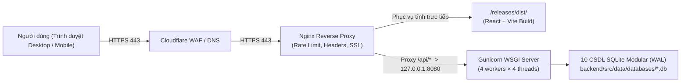

# HƯỚNG DẪN CHI TIẾT TRIỂN KHAI (DEPLOY) & CẬP NHẬT HỆ THỐNG TỬ VI HỒNG ÂN

**Dự án:** Website Tử Vi Hồng Ân (`tuvihongan.com`)  
**Kiến trúc:** Monorepo (Frontend React 19 + Vite • Backend Python Flask/Gunicorn • 10 CSDL SQLite Modular chế độ WAL • Nginx Reverse Proxy / Docker)  
**Cập nhật lần cuối:** 13/11/2026

---

## MỤC LỤC
1. [Tổng quan Kiến trúc Vận hành trên Máy chủ](#1-tổng-quan-kiến-trúc-vận-hành-trên-máy-chủ)
2. [Phần I: Quy trình Triển khai Lần đầu lên Máy chủ Linux (Initial Deployment)](#2-phần-i-quy-trình-triển-khai-lần-đầu-lên-máy-chủ-linux-initial-deployment)
3. [Phần II: Quy trình Cập nhật & Phát hành Giao diện Người dùng (UI/UX Frontend)](#3-phần-ii-quy-trình-cập-nhật--phát-hành-giao-diện-người-dùng-uiux-frontend)
4. [Phần III: Quy trình Cập nhật & Phát hành Hệ thống Xử lý Máy chủ (Backend & Database)](#4-phần-iii-quy-trình-cập-nhật--phát-hành-hệ-thống-xử-lý-máy-chủ-backend--database)
5. [Phần IV: Quy trình Điều chỉnh Bảng giá, Gói dịch vụ & Thanh toán](#5-phần-iv-quy-trình-điều-chỉnh-bảng-giá-gói-dịch-vụ--thanh-toán)
6. [Phần V: Sao lưu, Giám sát & Khôi phục Khẩn cấp (Rollback)](#6-phần-v-sao-lưu-giám-sát--khôi-phục-khẩn-cấp-rollback)

---

## 1. Tổng quan Kiến trúc Vận hành trên Máy chủ



- **Tài nguyên tĩnh Frontend:** Sau khi biên dịch từ `frontend/`, toàn bộ tệp HTML/CSS/JS tối ưu hóa (đã tắt source maps) được xuất ra thư mục `releases/dist/`.
- **Máy chủ API Backend:** Khởi chạy từ `backend/src/server.py` qua hàm khởi tạo `src.server:create_app()`, chỉ lắng nghe nội bộ tại `127.0.0.1:8080`.
- **Cơ sở dữ liệu:** 10 tệp SQLite chuyên biệt theo miền nghiệp vụ nằm tại `backend/src/data/databases/` vận hành ở chế độ `WAL` (`Write-Ahead Logging`), đi kèm thư mục lưu trữ ảnh `backend/src/data/storage/`.

---

## 2. Phần I: Quy trình Triển khai Lần đầu lên Máy chủ Linux (Initial Deployment)

### Bước 1: Chuẩn bị Máy chủ Linux & Tường lửa
Khuyến nghị hệ điều hành **Ubuntu 22.04 LTS hoặc 24.04 LTS** (tối thiểu 2 vCPU, 4 GB RAM, 40 GB SSD NVMe).

```bash
# 1. Cập nhật hệ thống và cài đặt các gói nền tảng
sudo apt update && sudo apt upgrade -y
sudo apt install -y git curl ufw nginx certbot python3-certbot-nginx sqlite3

# 2. Cấu hình tường lửa UFW (Chỉ mở SSH, HTTP, HTTPS; tuyệt đối KHÔNG mở cổng 8080 ra ngoài)
sudo ufw default deny incoming
sudo ufw default allow outgoing
sudo ufw allow 22/tcp
sudo ufw allow 80/tcp
sudo ufw allow 443/tcp
sudo ufw enable
sudo ufw status verbose

# 3. Tăng giới hạn tệp mở tối đa (Open Files Limit) phục vụ chịu tải >= 1.000 CCU
cat << 'EOF' | sudo tee -a /etc/security/limits.conf
* soft nofile 65535
* hard nofile 65535
root soft nofile 65535
root hard nofile 65535
EOF
```

---

### Bước 2: Tải Mã nguồn & Thiết lập Biến Môi trường (`backend/.env`)

```bash
# Tạo thư mục gốc cho ứng dụng
sudo mkdir -p /var/www/tuvihongan
sudo chown -R $USER:$USER /var/www/tuvihongan

# Clone mã nguồn vào thư mục
git clone <URL_REPO_CUA_BAN> /var/www/tuvihongan
cd /var/www/tuvihongan
```

Tạo tệp cấu hình môi trường `backend/.env` từ tệp mẫu `backend/.env.example`:

```bash
cp backend/.env.example backend/.env
chmod 600 backend/.env
nano backend/.env
```

Điền đầy đủ các biến môi trường bắt buộc cho môi trường Production:

```ini
# Cổng và chế độ cơ sở dữ liệu
HOST=127.0.0.1
PORT=8080
DATABASE_MODE=modular

# Khóa bí mật phiên (Sinh ngẫu nhiên bằng lệnh: python3 -c "import secrets; print(secrets.token_hex(32))")
SECRET_KEY=<chuoi_hex_ngau_nhien_64_ky_tu>

# Tuyệt đối tắt đăng nhập thử nghiệm và giả lập AI trên Production
ENABLE_DEV_LOGIN=false
MOCK_LLM_SERVICE=false
DISABLE_RATE_LIMIT=false

# Tên miền cho phép gọi API (CORS Whitelist)
CORS_ORIGIN=https://tuvihongan.com,https://www.tuvihongan.com
ALLOWED_ORIGINS=https://tuvihongan.com,https://www.tuvihongan.com

# Khóa Google OAuth & Gemini AI
GOOGLE_CLIENT_ID=714306691526-iq2uodqu69fdcdalibn2ipgia2t4lqvs.apps.googleusercontent.com
GEMINI_API_KEY=<khoa_gemini_api_thuc_te>

# Cấu hình Cổng thanh toán SePay & Ngân hàng thụ hưởng
SEPAY_API_KEY=<khoa_webhook_sepay_bi_mat>
SEPAY_BANK_NAME=MB
SEPAY_ACCOUNT_NO=8857159999
SEPAY_ACCOUNT_NAME=TU VI HONG AN
HOTLINE=0941300629

# Danh sách email Quản trị viên
MANAGER_EMAILS=tranngocxuanbach7@gmail.com
```

---

### Bước 3: Lựa chọn Phương thức Khởi chạy (Docker hoặc Systemd)

#### Phương thức A: Triển khai bằng Docker Compose (Khuyên dùng)
File `deployment/docker/Dockerfile` và `deployment/docker/docker-compose.yml` đã được cấu hình sẵn Multi-stage build (tự động build Frontend và chạy Backend bằng Gunicorn với user `appuser` không có quyền root, gắn cổng `127.0.0.1:8080:8080`).

```bash
cd /var/www/tuvihongan

# 1. Build và khởi chạy container ở chế độ nền
docker compose -f deployment/docker/docker-compose.yml up -d --build

# 2. Kiểm tra trạng thái container và phản hồi Health Check
docker ps
curl -i http://127.0.0.1:8080/api/health

# 3. Đồng bộ thư mục tĩnh đã build ra ngoài cho Nginx phục vụ trực tiếp (tùy chọn tăng tốc)
mkdir -p /var/www/tuvihongan/releases/dist
docker cp tuvi_hongan_app:/app/releases/dist/. /var/www/tuvihongan/releases/dist/
```

#### Phương thức B: Triển khai Trực tiếp trên Máy chủ Linux (Bare-metal / Systemd)
Nếu không dùng Docker, thực hiện tuần tự:

```bash
cd /var/www/tuvihongan

# 1. Cài đặt Node.js 20+ và biên dịch giao diện Frontend ra thư mục releases/dist/
cd /var/www/tuvihongan/frontend
npm ci
npm run build

# 2. Khởi tạo môi trường ảo Python và cài đặt thư viện Backend
cd /var/www/tuvihongan/backend
python3 -m venv .venv
source .venv/bin/activate
pip install --upgrade pip
pip install -r requirements.txt
playwright install --with-deps chromium

# 3. Phân quyền thư mục dữ liệu
mkdir -p /var/www/tuvihongan/backend/src/data/databases
chmod 750 /var/www/tuvihongan/backend/src/data
```

Tạo dịch vụ Systemd `/etc/systemd/system/tuvi-backend.service`:

```ini
[Unit]
Description=Tu Vi Hong An Gunicorn API Server
After=network.target

[Service]
User=www-data
Group=www-data
WorkingDirectory=/var/www/tuvihongan/backend
Environment="PYTHONPATH=/var/www/tuvihongan/backend:/var/www/tuvihongan/backend/src"
EnvironmentFile=/var/www/tuvihongan/backend/.env
ExecStart=/var/www/tuvihongan/backend/.venv/bin/gunicorn \
    --workers 4 \
    --threads 4 \
    --timeout 180 \
    --bind 127.0.0.1:8080 \
    "src.server:create_app()"
Restart=always
RestartSec=3
LimitNOFILE=65535

[Install]
WantedBy=multi-user.target
```

Kích hoạt dịch vụ:
```bash
sudo chown -R www-data:www-data /var/www/tuvihongan/backend/src/data /var/www/tuvihongan/releases
sudo systemctl daemon-reload
sudo systemctl enable --now tuvi-backend
sudo systemctl status tuvi-backend
```

---

### Bước 4: Cấu hình Nginx Reverse Proxy & Chứng chỉ SSL (HTTPS)

```bash
# 1. Sao chép cấu hình Nginx chuẩn của dự án
sudo cp /var/www/tuvihongan/deployment/nginx/nginx.conf /etc/nginx/sites-available/tuvihongan.conf
sudo ln -sf /etc/nginx/sites-available/tuvihongan.conf /etc/nginx/sites-enabled/tuvihongan.conf
sudo rm -f /etc/nginx/sites-enabled/default

# 2. Cấp chứng chỉ SSL Let's Encrypt cho tên miền
sudo certbot --nginx -d tuvihongan.com -d www.tuvihongan.com

# 3. Kiểm tra cú pháp Nginx và nạp lại
sudo nginx -t && sudo systemctl reload nginx
```

---

## 3. Phần II: Quy trình Cập nhật & Phát hành Giao diện Người dùng (UI/UX Frontend)

Sử dụng quy trình này khi bạn thay đổi **bố cục, màu sắc, phông chữ, hiệu ứng chuyển trang, nội dung văn bản tĩnh, trang Chính sách/Điều khoản hoặc thành phần React** bên trong thư mục `frontend/`.

### 3.1. Các vị trí tệp UI/UX thường xuyên cập nhật
| Khu vực giao diện | Đường dẫn tệp trong dự án |
| :--- | :--- |
| Định tuyến & Bảo vệ trang (`/admin`, `/chinh-sach`, `/dieu-khoan`) | `frontend/src/app/App.jsx` |
| Biến màu sắc, phông chữ toàn cục & hiệu ứng chuyển trang | `frontend/src/app/index.css`, `frontend/src/app/App.css` |
| Thanh điều hướng (Navbar) & Chân trang (Footer) | `frontend/src/shared/ui/Navbar.jsx`, `frontend/src/shared/ui/Footer.jsx`, `Footer.css` |
| Thông tin pháp lý chủ quản, Email DPO, Hotline dùng chung | `frontend/src/shared/constants/legalInfo.js` |
| Trang Chính sách Bảo mật & Điều khoản Sử dụng | `frontend/src/pages/policy/Policy.jsx`, `Policy.css` |
| Trang chủ Desktop (`> 580px`) & Mobile (`<= 580px`) | `frontend/src/pages/home/Home.jsx`, `HomeMobile.jsx`, `homeData.js` |
| Giao diện Lá số Tử Vi & Luận giải AI Gemini | `frontend/src/features/astrology/LaSoTuVi.jsx`, `AiInterpretationGeminiView.jsx` |
| Cửa sổ Đăng nhập Google & Checkbox đồng ý (NĐ 13/2023) | `frontend/src/features/auth/AuthModal.jsx`, `AuthModal.css` |

### 3.2. Các bước kiểm tra và phát hành thay đổi UI/UX

#### Bước 1: Kiểm tra cú pháp JSX tại máy cục bộ (Local)
Trước khi đẩy code lên Git, chạy công cụ `oxlint` để đảm bảo không có lỗi cú pháp React/JSX:
```bash
cd frontend
npx oxlint src/
```

#### Bước 2: Đẩy mã nguồn lên Git Repository
```bash
git add frontend/
git commit -m "ui: cap nhat giao dien nguoi dung"
git push origin main
```

#### Bước 3: Biên dịch và phát hành trên Máy chủ Linux
- **Nếu chạy trực tiếp (Systemd + Nginx):**
  ```bash
  cd /var/www/tuvihongan
  git pull origin main

  # Biên dịch bản build mới vào /var/www/tuvihongan/releases/dist
  cd /var/www/tuvihongan/frontend
  npm ci
  npm run build
  ```
  > **Lưu ý:** Khi chỉ cập nhật Frontend (HTML/CSS/JS), Vite sẽ tự động sinh mã băm (hash) mới cho các tệp trong `releases/dist/assets/` và Nginx sẽ phục vụ ngay lập tức mà **không cần khởi động lại Gunicorn hay Nginx**.

- **Nếu chạy bằng Docker Compose:**
  ```bash
  cd /var/www/tuvihongan
  git pull origin main
  docker compose -f deployment/docker/docker-compose.yml up -d --build
  docker cp tuvi_hongan_app:/app/releases/dist/. /var/www/tuvihongan/releases/dist/
  ```

---

## 4. Phần III: Quy trình Cập nhật & Phát hành Hệ thống Xử lý Máy chủ (Backend & Database)

Sử dụng quy trình này khi bạn thay đổi **logic tính toán lá số, prompt AI, phân quyền xác thực, API endpoints, cấu trúc bảng SQLite hoặc thư viện Python** bên trong thư mục `backend/`.

### 4.1. Các phân hệ Backend trọng yếu
| Phân hệ | Đường dẫn tệp chính | Lưu ý khi chỉnh sửa |
| :--- | :--- | :--- |
| Khởi tạo HTTP Server, Rate Limit, Security Headers | `backend/src/server.py`, `backend/src/core/config.py` | Kiểm tra kỹ biến môi trường trong `backend/.env`. |
| Quản lý 10 CSDL SQLite Modular & Schema/Indexes | `backend/src/core/db_manager.py`, `backend/src/core/db.py` | Mọi cột/chỉ mục mới phải dùng `IF NOT EXISTS` hoặc kiểm tra `PRAGMA table_info` để tự động di trú an toàn. |
| Xác thực Google OAuth, Session Cookie & Quyền NĐ 13/2023 | `backend/src/modules/auth/auth.py`, `admin_auth.py`, `routes_auth.py` | Không bật lại `ENABLE_DEV_LOGIN` trên môi trường Production. |
| Động cơ An sao Tử Vi (Vùng Đỏ) & Xuất PDF | `backend/src/modules/astrology/engine/*`, `exporter/export_pdf.py` | Giữ nguyên công thức an sao cổ truyền; luôn giữ `allow_local_path=False` khi xuất PDF. |
| Luận giải AI Gemini & Hỏi đáp Q&A | `backend/src/modules/astrology/api/routes_ai.py`, `interpreter/*` | Đảm bảo giữ decorator `@login_required` và kiểm soát hạn mức token. |

### 4.2. Các bước phát hành bản cập nhật Backend an toàn

#### Bước 1: Kiểm tra cú pháp Python trước khi commit
```bash
python3 -m py_compile backend/src/server.py backend/src/core/db.py backend/src/core/db_manager.py
```

#### Bước 2: Sao lưu nóng (Online Backup) toàn bộ 10 CSDL trên máy chủ trước khi cập nhật
Luôn chạy kịch bản sao lưu trước mọi đợt cập nhật Backend:
```bash
cd /var/www/tuvihongan
python3 deployment/scripts/backup_sqlite.py
```
Kịch bản sẽ tự động kiểm tra `PRAGMA integrity_check=ok` trên toàn bộ các tệp `.db` và nén thành tệp `backend/backups/tuvi_sqlite_backup_YYYYMMDD_HHMMSS.tar.gz`.

#### Bước 3: Kéo mã nguồn mới và khởi động lại dịch vụ Backend
- **Nếu chạy bằng Systemd:**
  ```bash
  cd /var/www/tuvihongan
  git pull origin main

  # Cài đặt thêm thư viện mới (nếu requirements.txt có thay đổi)
  source backend/.venv/bin/activate
  pip install -r backend/requirements.txt

  # Khởi động lại Gunicorn
  sudo systemctl restart tuvi-backend
  sudo systemctl status tuvi-backend
  ```
- **Nếu chạy bằng Docker Compose:**
  ```bash
  cd /var/www/tuvihongan
  git pull origin main
  docker compose -f deployment/docker/docker-compose.yml up -d --build
  ```

#### Bước 4: Xác minh API sau khi khởi động lại
```bash
curl -i http://127.0.0.1:8080/api/health
```
Đảm bảo nhận về `HTTP/1.1 200 OK` kèm các header bảo mật `X-Content-Type-Options: nosniff` và `X-Frame-Options: SAMEORIGIN`.

---

## 5. Phần IV: Quy trình Điều chỉnh Bảng giá, Gói dịch vụ & Thanh toán

Hệ thống thanh toán của **Tử Vi Hồng Ân** áp dụng **cơ chế bảo vệ giá 2 lớp**:
1. **Lớp Giao diện (Frontend):** Hiển thị tên gói, giá tiền định dạng (`199.000 VNĐ`, `500.000 VNĐ`), quyền lợi gói và truyền `service_type` lên máy chủ khi tạo mã QR.
2. **Lớp Máy chủ (Backend - Nguồn chân lý bắt buộc):** Bất kể client gửi số tiền (`amount`) là bao nhiêu, máy chủ luôn đối chiếu `service_type` với bảng giá chuẩn `CANONICAL_SERVICE_PRICES` trong `backend/src/modules/billing/service.py` để ấn định số tiền thật trên đơn hàng và kiểm tra số tiền chuyển khoản thực tế từ SePay Webhook (`transferAmount >= order.amount`).

Do đó, khi thay đổi giá dịch vụ hoặc thêm gói mới, **bắt buộc phải cập nhật đồng bộ cả Backend và Frontend** theo bảng chỉ dẫn chi tiết dưới đây.

### 5.1. Bảng tra cứu đầy đủ các tệp cần sửa khi thay đổi Bảng giá & Gói dịch vụ

#### A. Phía Backend (Bắt buộc cập nhật để đổi số tiền thu thực tế trên VietQR & SePay)
| STT | Đường dẫn tệp | Dòng / Hằng số cần sửa | Vai trò cụ thể |
| :---: | :--- | :--- | :--- |
| 1 | `backend/src/modules/billing/service.py` | Dòng `18–22`: `CANONICAL_SERVICE_PRICES` | **Quan trọng nhất:** Quy định mức giá chuẩn (VNĐ, kiểu số nguyên) cho từng mã gói: `"lifetime": 199000`, `"ai_reading": 199000`, `"consultation": 500000`. |
| 2 | `backend/src/modules/billing/service.py` | Dòng `29–35`: `get_bank_config()` (hoặc sửa trong `backend/.env`) | Cấu hình ngân hàng nhận tiền (`SEPAY_BANK_NAME`, `SEPAY_ACCOUNT_NO`, `SEPAY_ACCOUNT_NAME`, `HOTLINE`). |
| 3 | `backend/src/core/customer_store.py` | Dòng `28–42`: `CHAT_WELCOME_MESSAGE` | Tin nhắn tự động trong khung Chat CSKH báo phí luận giải trực tiếp 1-1 (`500.000đ`) và thông tin số tài khoản MB Bank. |
| 4 | `backend/src/modules/courses/repository.py` | Dòng `33, 51, 84`: khóa `"price"` trong `SEED_COURSES` | Học phí niêm yết của các khóa học Tử Vi (ví dụ: `2500000`, `5000000`, `4500000`). |
| 5 | `backend/src/modules/shop/repository.py` | Dòng `31, 66`: `"price"` / `"original_price"` | Giá bán các vật phẩm phong thủy trong cửa hàng. |

#### B. Phía Frontend (Cập nhật số tiền hiển thị trên giao diện & cửa sổ thanh toán)
| STT | Đường dẫn tệp | Dòng / Hằng số cần sửa | Vai trò cụ thể |
| :---: | :--- | :--- | :--- |
| 1 | `frontend/src/pages/home/homeData.js` | Dòng `470–496`: hằng số `PACKAGES` (`ai199`, `direct500`) | Chứa `title`, `price` (chuỗi hiển thị, vd `'199.000 VNĐ'`), `amount` (số nguyên `199000`), `serviceType` (`'lifetime'` / `'consultation'`), `description` và danh sách `benefits`. |
| 2 | `frontend/src/pages/home/Home.jsx` | Dòng `932` và dòng `1034` | Nhãn giá hiển thị trực tiếp trên 2 thẻ dịch vụ tại Trang chủ bản Desktop (`199.000đ`, `500.000đ`). |
| 3 | `frontend/src/pages/home/HomeMobile.jsx` | Dòng `1171` và dòng `1270` | Nhãn giá hiển thị trực tiếp trên 2 thẻ dịch vụ tại Trang chủ bản Mobile (`199.000đ`, `500.000đ`). |
| 4 | `frontend/src/features/astrology/LaSoTuViContainer.jsx` | Dòng `18–39`: `AI_PACKAGE_199K` và `DIRECT_PACKAGE_500K` | Thông tin gói dịch vụ (`price`, `amount`, `benefits`) truyền vào `PaymentModal` khi khách hàng bấm mua tại trang Lá Số Tử Vi (`/la-so-tu-vi`). |
| 5 | `frontend/src/features/astrology/AiInterpretationGeminiView.jsx` | Dòng `1766–1775`: prop `packageInfo` của `<PaymentModal />` | Thông tin gói Luận giải AI (`price: '199.000 VNĐ'`, `amount: 199000`) khi mở modal mua lượt tại trang Luận Giải AI (`/luan-giai-ai`). |
| 6 | `frontend/src/features/billing/components/PaymentModal.jsx` | Dòng `185–216` và dòng `285` | Giá trị fallback mặc định và điều kiện nhận diện gói tư vấn 1-1 trong cửa sổ hiển thị mã QR thanh toán. |

---

### 5.2. Ví dụ Thực tế: Các bước đổi giá gói "Luận giải AI" (ví dụ từ `199.000đ` sang `249.000đ`)

1. **Bước 1 — Sửa giá chuẩn trên Backend (`backend/src/modules/billing/service.py`):**
   ```python
   CANONICAL_SERVICE_PRICES: Dict[str, int] = {
       "consultation": 500000,
       "lifetime": 249000,
       "ai_reading": 249000,
   }
   ```
2. **Bước 2 — Sửa dữ liệu gói trên Frontend:**
   - Trong `frontend/src/pages/home/homeData.js`: đổi `price: '249.000 VNĐ'` và `amount: 249000` ở `PACKAGES.ai199`.
   - Trong `frontend/src/pages/home/Home.jsx` (dòng 932) & `HomeMobile.jsx` (dòng 1171): đổi chuỗi hiển thị thành `249.000đ`.
   - Trong `frontend/src/features/astrology/LaSoTuViContainer.jsx` (dòng 20–21), `AiInterpretationGeminiView.jsx` (dòng 1768–1769) và `PaymentModal.jsx` (dòng 185–186, 201, 216, 285): đồng bộ `249.000 VNĐ` và `249000`.
3. **Bước 3 — Kiểm tra & Build lại cả Frontend và Backend:**
   ```bash
   # Kiểm tra cú pháp
   python3 -m py_compile backend/src/modules/billing/service.py
   cd frontend && npx oxlint src/

   # Trên máy chủ: build lại Frontend và khởi động lại Backend
   cd /var/www/tuvihongan/frontend && npm run build
   sudo systemctl restart tuvi-backend   # Hoặc: docker compose -f deployment/docker/docker-compose.yml up -d --build
   ```
4. **Bước 4 — Kiểm tra thực tế sau khi phát hành:**
   - Mở trang chủ `https://tuvihongan.com/#service`, bấm vào gói **Luận Giải AI**.
   - Kiểm tra cửa sổ `PaymentModal` hiển thị đúng số tiền mới và ảnh mã VietQR tạo ra có tham số `amount=249000` cùng nội dung chuyển khoản `TVHAxxxxxxxx`.

---

## 6. Phần V: Sao lưu, Giám sát & Khôi phục Khẩn cấp (Rollback)

### 6.1. Cài đặt Lịch Sao lưu Tự động Hàng ngày (Cronjob)
Thiết lập `crontab -e` trên máy chủ Linux để tự động sao lưu toàn bộ 10 CSDL SQLite WAL và dọn dẹp phiên đăng nhập hết hạn vào 03:00 sáng mỗi ngày:

```bash
0 3 * * * /usr/bin/python3 /var/www/tuvihongan/deployment/scripts/backup_sqlite.py --data-dir /var/www/tuvihongan/backend/src/data --backup-dir /var/www/tuvihongan/backend/backups --retention-days 30 >> /var/log/tuvi_backup.log 2>&1
```

### 6.2. Quy trình Khôi phục Nhanh (Rollback) khi Phát sinh Sự cố sau Cập nhật

#### Trường hợp 1: Khôi phục Mã nguồn (Code Rollback) về Phiên bản Trước đó
```bash
cd /var/www/tuvihongan

# Xem lịch sử commit gần nhất
git log --oneline -n 5

# Quay lui về commit ổn định liền trước
git checkout <ma_commit_on_dinh>

# Nếu cần build lại giao diện và khởi động lại Backend:
cd /var/www/tuvihongan/frontend && npm run build
sudo systemctl restart tuvi-backend
```

#### Trường hợp 2: Khôi phục Cơ sở Dữ liệu từ Bản Sao lưu `.tar.gz`
```bash
# 1. Tạm dừng dịch vụ Backend để đóng toàn bộ kết nối SQLite
sudo systemctl stop tuvi-backend   # Hoặc: docker compose -f deployment/docker/docker-compose.yml stop

# 2. Giải nén bản sao lưu gần nhất đè vào thư mục dữ liệu
tar -xzf /var/www/tuvihongan/backend/backups/tuvi_sqlite_backup_<YYYYMMDD_HHMMSS>.tar.gz \
    -C /var/www/tuvihongan/backend/src/

# 3. Cấp lại quyền sở hữu tệp và khởi động lại dịch vụ
sudo chown -R www-data:www-data /var/www/tuvihongan/backend/src/data
sudo systemctl start tuvi-backend
```
